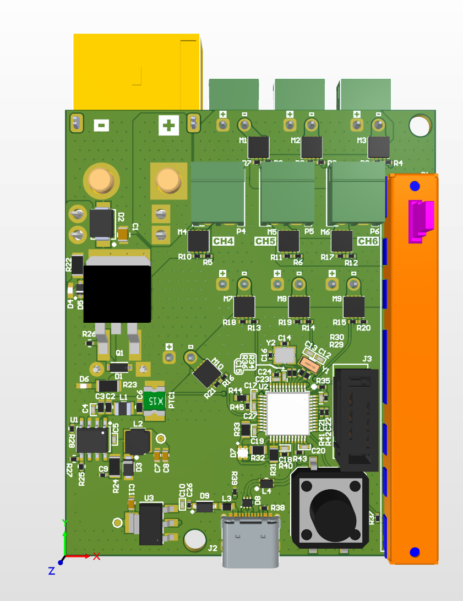

# Multi-Channel High-Current LED Controller

A **10-channel LED controller** that switches high-current 12 V LED loads from a single board — up to **2.5 A per channel (25 A total)** — driven by an **STM32** microcontroller over native **USB**. Designed end to end: schematic, PCB layout and firmware.

> Design files are not published. This repository documents the project through 3D renders and a technical write-up.

<!-- Add the exported Altium renders here once generated -->
| Top view | Bottom view |
| --- | --- |
|  |  |

## How it works

Each of the ten outputs is a **low-side N-channel MOSFET** (IRF7832) switch: the MCU drives the gate through a series resistor with a pull-down for a defined off-state, so each channel can sink a high-current 12 V LED string independently. A user-facing **analog slider** and a **mode button** set brightness and operating modes, and an on-board **RGB status LED** shows state. The controller connects to a host over **USB-C** for control and configuration.

```
USB host → STM32 (native USB) → 10× low-side MOSFET channels → 12 V LED connectors
                     ↑
        analog slider + mode button (UI)
```

## Design highlights

- **10 independent high-current channels** — each an IRF7832 low-side N-MOSFET with gate series resistor and pull-down; sized for 2.5 A per channel, up to 25 A total, with attention to copper and thermal layout.
- **Protected dual power front end** — 12 V input with resettable PTC fuse, TVS transient protection and a reverse-polarity P-MOSFET; an LMR16006 buck generates the logic rail, a USB-C path supplies an alternate source through an LD1117 LDO, and a **TPS2116 power mux** selects between the two inputs automatically.
- **STM32F103 (Cortex-M3) with native USB** — USB-C data interface for host control, 8 MHz main crystal and a 32.768 kHz RTC crystal, SWD debug header.
- **Clean user interface** — analog slider input on an ADC channel, mode button, and an RGB status indicator plus discrete status LEDs.

## Firmware

Bare-metal C on STM32: USB device interface for host commands, per-channel output control (on/off and brightness via PWM), and reading of the slider and button for local control.

## Status

Hardware complete — schematic, PCB and firmware.

## Note on files

The source design (schematic, PCB and fabrication files) is kept private. If you would like to discuss the design in more detail, feel free to reach out.
