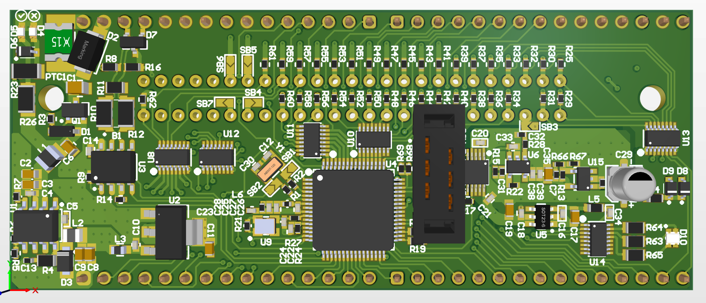
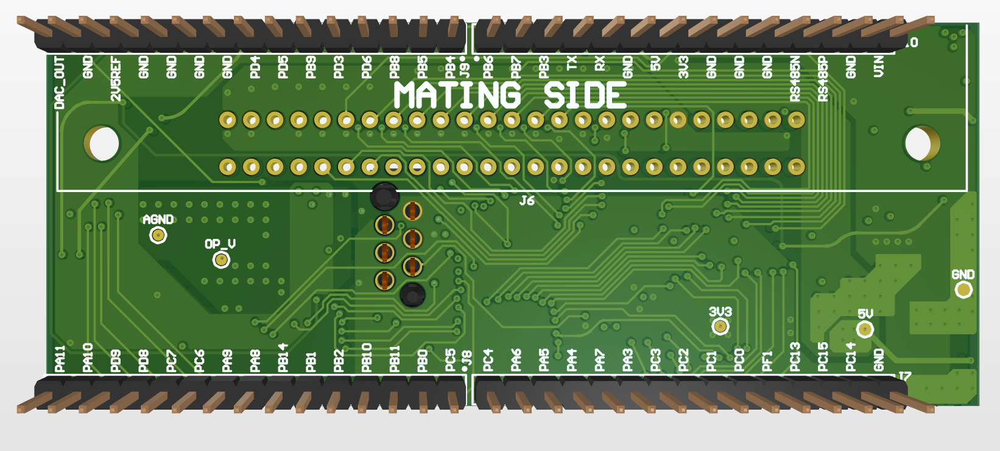
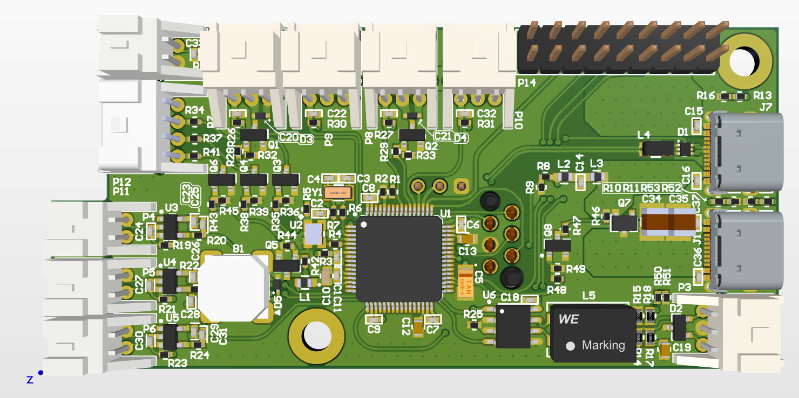
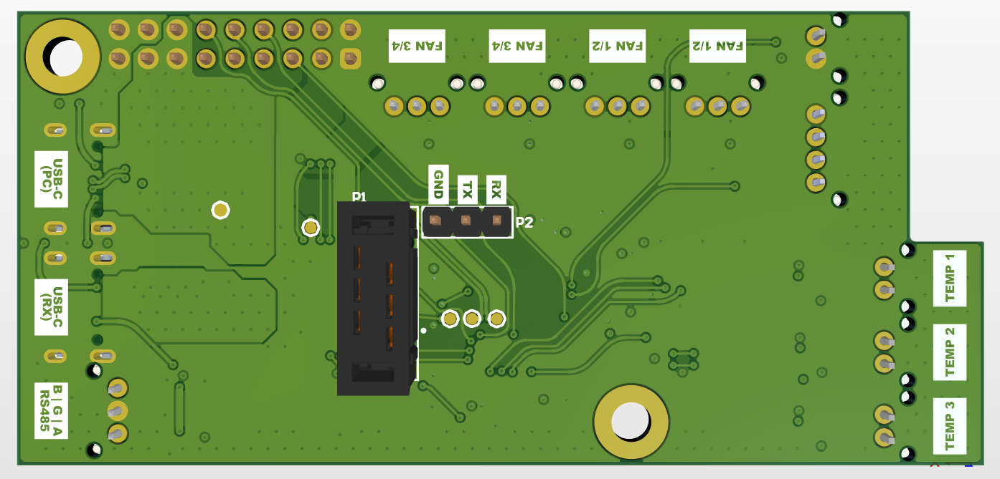
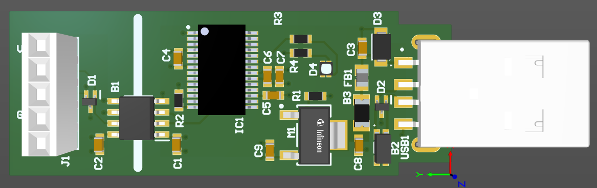

# Other Projects

A gallery of additional boards I have designed. These are shown as renders only — no schematics, specifications or write-ups.

> Source design files are not published, and these projects are shown without technical detail.

## DAC/DevBoard

| | |
| --- | --- |
|  |  |

## Power Supply Controller

| | |
| --- | --- |
|  |  |

## USB to Uart (my first PCB)

| | |
| --- | --- |
|  |
